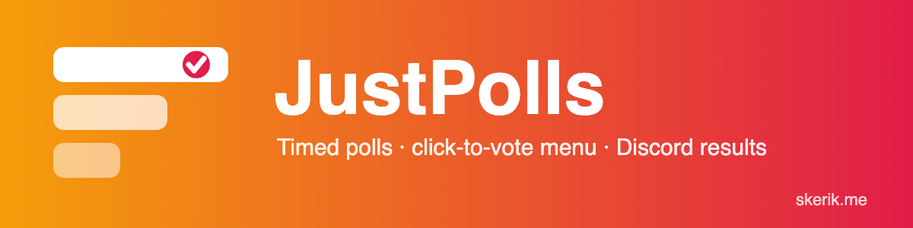

# JustPolls Wiki

**Timed in-game polls with a clickable dialog menu, SQLite/MariaDB storage and Discord webhook results.**

Staff create a poll (10 minutes, an hour, a week, ...) in a menu, with one chat command, or in `config.yml`. Players get the voting menu popping up by themselves, click an answer and that is it: **one vote per player and poll**. When time is up the results (percentages and totals, never who voted) are announced in chat and, if you want, posted to a Discord channel.

The menus use the native **dialog screens** introduced in Minecraft 1.21.6 (buttons, text fields, drop-downs, checkboxes), so there is no inventory GUI and nothing for players to install.

| | |
| :--- | :--- |
| **Platform** | Paper (built and tested against Minecraft `26.3`), Folia-ready by design |
| **Java** | 25 or newer |
| **Storage** | SQLite (default) or MariaDB / MySQL |
| **Languages** | English, Czech (every text editable, MiniMessage) |
| **License** | MIT |
| **Download** | [Modrinth](https://modrinth.com/plugin/oi0pQjlz) · Hangar · [GitHub Releases](https://github.com/filasik/justPolls/releases) |
| **Source / issues** | [github.com/filasik/justPolls](https://github.com/filasik/justPolls) |

## Where to start

| I want to... | Read |
| :--- | :--- |
| Install JustPolls | [Installation](Installation) |
| Understand every option in `config.yml` | [Configuration](Configuration) |
| See every command and permission | [Commands and Permissions](Commands-and-Permissions) |
| Tell my players how to vote | [Player Guide](Player-Guide) |
| Create, extend, end or cancel polls | [Creating and Managing Polls](Creating-and-Managing-Polls) |
| Run a poll every week automatically | [Scheduled and Repeating Polls](Scheduled-and-Repeating-Polls) |
| Post results to a Discord channel | [Discord Webhook](Discord-Webhook) |
| Use MariaDB or share polls between servers | [Storage and Database](Storage-and-Database) |
| Translate or restyle the messages | [Messages and Localization](Messages-and-Localization) |
| Know what is stored about voters | [Privacy](Privacy) |
| Fix a problem | [FAQ and Troubleshooting](FAQ-and-Troubleshooting) |
| Build the plugin or contribute | [Building and Contributing](Building-and-Contributing) |

## Features

- **Menu-driven** – create, manage, extend, end or cancel polls in dialogs (`/justpolls create`, `/justpolls manage`).
- **Any duration** – `30s`, `10m`, `1h`, `1d12h`, `7d`, `2w`. Polls can also be scheduled to start later.
- **Auto-open** – the voting menu opens by itself after a poll starts, when players join, and optionally as a reminder. Every delay is configurable; players can opt out with `/justpolls autoopen off`.
- **One vote per player** (optionally changeable while the poll runs). Votes are stored under a salted hash, not next to the player's UUID.
- **Discord webhook** – a formatted embed with a bar, percentage and vote count per option, the winner (or tie), total votes and duration; optional role mention and a "poll started" message.
- **SQLite or MariaDB/MySQL** – all database work is asynchronous; several servers can share one database.
- **Polls in `config.yml`** – fixed polls that start at a date and can repeat (weekly event vote, ...).
- **Results visibility** – after voting, always live, or only after the poll ends.
- **Participation rewards** – optional console commands run when a player votes.
- **Per-poll permission** – limit a poll to players with a given permission (e.g. VIPs).
- **Translations** – English (default) and Czech; every text is editable.
- **Folia-ready** – no `BukkitScheduler`; everything goes through region, global and async schedulers.

## How a poll works

1. A poll is **scheduled** (it has a start time in the future) or **active** (running).
2. While it is active, players with permission vote once from the dialog menu. Optional rewards run on the first vote.
3. When the end time is reached the poll becomes **ended**: results are announced in chat and, if enabled, sent to Discord.
4. Staff can end it early, change its end, **cancel** it (votes kept, no results published) or **delete** it together with its votes.

## Support the project

The plugin is free. If you like it you can contribute voluntarily (no in-game perks): see the Sponsor links on [GitHub](https://github.com/filasik/justPolls).
